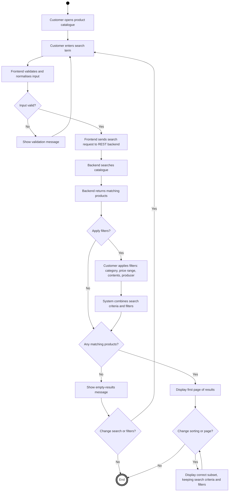
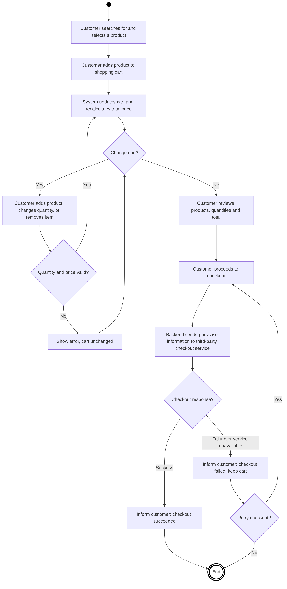
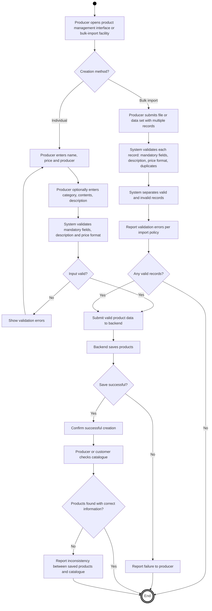

# Test Plan — E-commerce Store
**Initial report / Draft 0.1**

## Cover page

- **Document:** Test Plan — Part 1
- **Course ID and name:** COMP.SE.200-2026-2027-1 Software Testing
- **Group number:** 31
- **Student 1:** Pham Thanh
- **Student 2:** Georgios Malezoglou

## Definitions, acronyms and abbreviations

| Term | Definition |
|---|---|
| API | Application Programming Interface |
| CI | Continuous Integration |
| E2E | End-to-end testing |
| SUT | System under test |
| REST | Representational State Transfer, an architectural style for network APIs |
| Unit test | A test of one small unit of code in isolation |
| Code coverage | A measure of which code is executed by tests |
| Quality gate | A condition that must be satisfied before testing or a change is accepted |

# 1. Introduction

## 1.1 Purpose

This test plan describes how the team intends to assess the suitability of a utility library for use in an e-commerce store. It defines three end-to-end scenarios, the proposed testing scope and prioritisation method, the test environment, test reporting and defect tracking, quality criteria, and other testing recommended for the complete application.

Part 1 is planning work. Part 2 will implement unit tests only for the applicable utility-library files selected in this plan.

## 1.2 Introduction

The store sells food products from small producers. Customers can search and filter by name, category, price, contents, and producer; add products to a cart; and see the total price update. Checkout and payment are handled by a third-party service. Producers can add products individually through the frontend or import products in bulk through an existing portal. Product name, price, and producer are mandatory; some attributes, such as category and contents, may be omitted.

The frontend is expected to validate user input, including descriptions and prices, and support pagination for large search results. A REST backend provides core operations such as searching, buying, adding and removing products, and accessing third-party services.

The utility library to be assessed is: https://github.com/otula/COMP.SE.200-2024-2025-1

# 2. Context of testing

## 2.1 End-to-End Scenarios

The following three end-to-end scenarios describe the main workflows of the e-commerce store. Each scenario includes the expected workflow, important validation and failure conditions, and potential utility library functions that could support its implementation. These scenarios also provide a basis for prioritising the utility library files for unit testing. The function names below are candidates for investigation, not confirmed implementation dependencies.

### Scenario 1: Product Search, Filtering, and Pagination

**Goal:** Ensure that customers can find the correct food products using search, filters, and pagination.

**Preconditions:**
- The product catalogue contains products from multiple producers.
- Products have names, prices, and producer information; some products may have no category or contents specified.
- The product catalogue contains enough products to require multiple pages.

**Main workflow:**

1. The customer opens the product catalogue.
2. The customer enters a product name or keyword in the search field.
3. The frontend validates the search input and sends the search request to the REST backend.
4. The backend searches the catalogue and returns matching products.
5. The customer applies one or more filters, such as category, price range, contents, or producer.
6. The system combines the search criteria and filters and displays only matching products.
7. The customer changes the sorting order or navigates to another results page.
8. The system displays the correct subset of products without losing the applicable search criteria or filters.
9. If no products match, the system displays an appropriate empty-results message.

**Important conditions and risks:**
- Search terms may be empty, contain extra spaces, or have different capitalisation.
- Products may have missing optional attributes.
- Price filters must handle valid boundaries and avoid including products outside the selected range.
- Pagination must handle empty results, the last page, and changes in the number of matching products.
- Combining multiple filters must not return products that violate any active criterion.

**Potentially relevant utility library functions:**

- `filter.js` may support selecting products that satisfy search or filter conditions.
- `every.js` may support checking that a product satisfies all active filter criteria at once.
- `map.js` may support transforming product data for display.
- `toNumber.js` may support converting price-range input to numbers before comparing.
- `isEmpty.js` may support detecting empty search input and empty result sets.
- `defaultTo.js` may support handling products with missing optional attributes such as category or contents.
- `slice.js` or `chunk.js` may support splitting results into pages, depending on the chosen pagination implementation.

These functions should be examined in the supplied repository before being selected for testing. Their relevance depends on their actual behaviour and how the application would use them.

**Prioritisation rationale:** High priority because product discovery is a core customer workflow. Incorrect filtering or pagination can hide available products or display products that do not match the customer's requirements.

**UML activity diagram:**

### Scenario 2: Shopping Cart, Quantity Updates, and Checkout

**Goal:** Ensure that customers can manage their shopping cart, see accurate totals, and proceed to the third-party checkout service.

**Preconditions:**
- The catalogue contains available products with valid prices.
- The customer can access the product catalogue and shopping cart.
- A third-party checkout service is available for payment processing.

**Main workflow:**

1. The customer searches for and selects a product.
2. The customer adds the product to the shopping cart.
3. The customer adds more products, changes the quantity of an item (increase or decrease), or removes an item.
4. After each change, the system updates the cart contents and recalculates the total price.
5. The customer reviews the products, quantities, and total price.
6. The customer proceeds to checkout.
7. The backend sends the required purchase information to the third-party checkout service.
8. The system handles the checkout response and informs the customer whether the checkout process succeeded or failed.

**Important conditions and risks:**
- Quantities must be valid; malformed, zero, or negative quantities must be handled according to the application's rules.
- Prices must retain the required two-decimal accuracy.
- The total must be recalculated correctly when products or quantities change.
- Removing the final item must result in a correctly updated empty cart.
- Invalid product prices must not silently produce incorrect totals.
- A failed or unavailable third-party checkout service must be handled without falsely reporting a successful payment.
- Repeated checkout requests must be considered to reduce the risk of duplicate purchases.

**Potentially relevant utility library functions:**

- `add.js` may support adding item prices when calculating the cart total (floating-point results such as 0.1 + 0.2 are a risk to check).
- `reduce.js` may support summing line totals into the cart total.
- `toNumber.js` may support converting price and quantity input to numbers before calculation.
- `toInteger.js` may support ensuring that quantities are whole numbers.
- `clamp.js` may support restricting a quantity to an allowed range.
- `isEmpty.js` may support detecting an empty cart after the last item is removed.

These are candidates only. The application may use other arithmetic or validation logic, and financial calculations require particular attention to rounding and decimal precision.

**Prioritisation rationale:** High priority because errors in quantities or price calculations can directly affect purchases and customer trust. Checkout failures may also prevent customers from completing transactions.

**UML activity diagram:**

### Scenario 3: Producer Product Creation and Bulk Import

**Goal:** Ensure that producers can add products individually or through bulk import, with mandatory information validated and optional attributes handled correctly.

**Preconditions:**
- The producer has access to the product management interface or import facility.
- The application defines the required product fields and validation rules.
- The REST backend provides product management functionality.

**Main workflow:**

1. The producer opens the product management interface or selects the bulk-import facility.
2. For individual creation, the producer enters the product name, price, and producer information.
3. The producer optionally enters attributes such as category, contents, and product description.
4. For bulk import, the producer submits a file or data set containing multiple product records.
5. The system validates mandatory fields, product descriptions, price formats, and other applicable input rules.
6. The system distinguishes valid records from invalid records and reports validation errors according to the application's import policy.
7. Valid product data is submitted to the backend and saved.
8. The system confirms successful creation or reports failures.
9. The producer or a customer checks the catalogue to confirm that saved products can be found and that their information is correct.

**Important conditions and risks:**
- Product name, price, and producer information are mandatory.
- Optional fields such as category and contents may be left empty.
- Prices must follow the required two-decimal accuracy.
- Product descriptions should follow the defined formatting and validation rules.
- Missing, malformed, or inconsistent data must not silently create invalid products.
- Bulk imports may contain a mixture of valid and invalid records, duplicate records, or large numbers of products.
- The system must report import outcomes clearly and maintain consistency between saved products and the catalogue.

**Potentially relevant utility library functions:**

- `toNumber.js` may support converting submitted price values into numbers before validating the format.
- `upperFirst.js` may support enforcing an upper-case first letter in product descriptions (`capitalize.js` is less suitable because it lowercases the rest of the text).
- `isEmpty.js` may support detecting missing mandatory fields such as name, price or producer.
- `every.js` may support checking that all mandatory fields are present in a record.
- `defaultTo.js` may support handling blank optional fields such as category or contents.
- `countBy.js` may support detecting duplicate records in a bulk import.

The description-formatting functions must not be assumed to implement complete sentence validation. Their actual behaviour should be inspected, and additional validation may be necessary.

**Prioritisation rationale:** High priority because invalid product data can affect catalogue quality, customer search results, and subsequent purchases. Bulk import also presents risks involving data consistency and the handling of multiple records.

**UML activity diagram:**

### Relationship Between Scenarios and Test Prioritisation

The scenarios identify operations that may be supported by the utility library, including filtering collections, transforming values, handling numbers, performing arithmetic operations, and processing subsets of data. These operations provide an initial basis for identifying candidate source files for unit testing.

The final selection of up to ten source files will be made after inspecting the actual implementations in the supplied repository. Each candidate will be evaluated according to its relevance to the scenarios, potential impact of failure, complexity of edge cases, and testability. The selection will not be based on filenames alone, and functions that are not relevant to the planned workflows may be excluded even if they are available in the library.
\`\`\`

## 2.2 Testing scope

This section defines what will be tested in the library and why. Because only 10 of the 44 source files in `src` can be unit tested, the files are selected with a risk-based prioritisation. The `.internal` directory is assumed to be tested and working, so it is excluded from testing and coverage. The store's front-end, REST back-end and the third-party payment service are outside the unit-test scope; they are covered in Section 4.3.

### Prioritisation method

Each candidate file from the scenarios is scored from 1 (low) to 3 (high) on three factors:

- **Scenario coverage:** how many of the three scenarios use the function.
- **Impact of failure:** how serious a defect would be for the store (for example, a wrong cart total is high impact).
- **Defect likelihood:** how complex the function is and how many edge cases it has, including problems seen when reading the code.

The three scores are added up, and the 10 highest-scoring files are selected. Ties are resolved in favour of the file with the higher impact of failure. The full scoring table is in Appendix D.

### Selected Source Files

The following table will document the final selection of ten files.

### Prioritisation scores (candidate files)

Scores: 1 = low, 3 = high. Scenario coverage = number of scenarios (1-3) that use the function. Total = sum of the three scores. Ties are resolved by the higher impact of failure.

| Rank | File | Scenarios | Scenario coverage | Impact of failure | Defect likelihood | Total | Selected |
|------|------|-----------|-------------------|-------------------|-------------------|-------|----------|
| 1 | `toNumber.js` | 1, 2, 3 | 3 | 3 | 2 | 8 | Yes |
| 2 | `filter.js` | 1 | 1 | 3 | 3 | 7 | Yes |
| 3 | `chunk.js` | 1 | 1 | 3 | 3 | 7 | Yes |
| 4 | `isEmpty.js` | 1, 2, 3 | 3 | 2 | 2 | 7 | Yes |
| 5 | `add.js` | 2 | 1 | 3 | 2 | 6 | Yes |
| 6 | `countBy.js` | 3 | 1 | 2 | 3 | 6 | Yes |
| 7 | `reduce.js` | 2 | 1 | 3 | 1 | 5 | Yes (tie-break: impact) |
| 8 | `every.js` | 1, 3 | 2 | 2 | 1 | 5 | Yes |
| 9 | `defaultTo.js` | 1, 3 | 2 | 2 | 1 | 5 | Yes |
| 10 | `slice.js` | 1 | 1 | 2 | 2 | 5 | Yes |
| 11 | `clamp.js` | 2 | 1 | 1 | 3 | 5 | No (lower impact) |
| 12 | `toInteger.js` | 2 | 1 | 2 | 1 | 4 | No |
| 13 | `toString.js` | 1 | 1 | 1 | 2 | 4 | No |
| 14 | `upperFirst.js` | 3 | 1 | 1 | 1 | 3 | No |

Four further candidates (clamp, toInteger, toString, upperFirst) scored lower and were not selected; see Appendix D.

suggested file:
1. chunk.js, slice.js – pagination
2. map.js – transform data
3. toNumber.js, toFinite.js, toInteger.js – price & quantity
4. add.js – sum quantity
5. clamp.js – limit quantity/price
6. isEmpty.js - check empty data
7. filter.js – search & filter

### Scope and Responsibilities

Testing is limited to the ten selected source files in the provided
utility library. Tests will focus on the exported functions and their
expected behaviour, including normal inputs, boundary conditions,
and invalid inputs where applicable.

The application's frontend, backend, REST API integration, payment
service, and complete end-to-end execution are outside the direct
testing scope because their implementations are not provided.

The `.internal` directory is excluded from testing and coverage
calculations according to the assignment assumptions. No source-code
fixes are required. Any detected defects will be documented and
reported.

The selected utilities may support the described end-to-end scenarios,
but testing these utilities alone does not establish that the complete
application workflows function correctly.

## 2.3 Assumptions and limitations

1. The provided utility library is the primary subject of testing. The application's frontend, backend, REST API integrations, and payment service are outside the direct testing scope because their implementations are not provided.
2. The utility functions will be tested independently using their exported interfaces. Expected behaviour will be determined from the available source code and applicable documentation.
3. The .internal directory is assumed to contain functions that have already been tested and are working correctly, as specified in the assignment. These files are excluded from testing and coverage calculations.
4. The three end-to-end scenarios describe intended application behaviour and provide context for prioritising utility functions. They do not imply that the complete application can be executed or tested end to end.
5. The purpose of testing is to identify and document defects, not to modify or repair the provided source code.

# 3. Tools and reporting

## 3.1 Proposed testing environment and tools

The toolchain must be confirmed after inspecting `package.json`, the existing project scripts, module format and dependencies. The following is a considered starting proposal; it is not a claim that all tools have already been installed or tested. (need to decide)

| Tool | Purpose in this assignment | Decision |
|---|---|---|
| Git and GitHub | Version control, collaboration, pull requests and review | Use |
| Jest **or** Mocha | Run unit tests and organise test suites | Choose one after compatibility check |
| Chai | Readable assertions if Mocha is selected and the project needs a separate assertion library | Conditional |
| c8 | Measure line, function, statement and branch coverage where supported | Evaluate for compatibility |
| GitHub Actions | Automatically run tests in CI when changes are pushed or pull requests are updated | Required in Part 2 |
| Coveralls | Publish and track test coverage from CI | Required in Part 2 |
| Testdouble | Stub or mock dependencies if a selected function requires isolation | Optional |
| Mochawesome or mocha-lcov-reporter | Produce a detailed report if Mocha is selected and the default output is insufficient | Optional; avoid duplicate reporters |
| WebSequenceDiagrams | Create sequence diagrams if the group chooses sequence diagrams rather than the Mermaid activity diagrams in this draft | Optional |

suggested: git+github, jest, c5, github actions, coveralls, node.js+npm

### Local setup plan

1. Clone the provided repository.
2. Read `package.json`, the lockfile, README, source layout and existing tests.
3. Install dependencies using the package manager indicated by the project.
4. Select a compatible test framework and configure a test script.
5. Run a small local test to verify the framework before adding the selected tests.
6. Configure coverage and explicitly exclude `.internal`.
7. Record the exact commands and versions used so another tester can reproduce the environment.
8. In Part 2, configure GitHub Actions to run the tests and Coveralls to receive the coverage report.

The assignment says CI and Coveralls setup are part of Part 2, so they do not need to be implemented in this phase.

## 3.2 Test result reporting

During testing, the team will record test execution progress, including the number of tests executed, passed, failed, and remaining. Test results will be documented by comparing actual outcomes with expected outcomes.

Any detected defects will be recorded with the affected source file, relevant test case, input data, expected result, actual result, and steps to reproduce the failure where applicable. Defects will be documented rather than fixed, in accordance with the assignment requirements.

After testing is completed, the team will provide a final test report summarising the test results, known defects, and code coverage for the selected source files. Coverage calculations will exclude the .internal directory. The final deliverables will include the test cases, test code, test execution results, coverage report, and a summary of testing limitations.

Each test run should be traceable to the code version tested. Record:

- Date, branch and commit identifier.
- Environment and test/coverage commands.
- Total, passed, failed and skipped tests.
- Failure details and relevant error output.
- Coverage results, with `.internal` excluded.
- Known limitations, blocked tests and environment issues.
- Related defect or pull-request links.

Report both successes and failures. A test failure should be investigated; it is not automatically proof of a defect in the library, because the test or environment may also be incorrect.

## 3.3 Defect Tracking 

### Defect Tracking Tool

The team will use GitHub Issues to record and track defects discovered during testing. Each defect will be documented as a separate issue and linked to the relevant source file and test case where possible. This provides a central location for recording defects, assigning responsibility, monitoring their status, and reviewing test findings.

### Defect Life Cycle

The team will track the following defect statuses:

- **New:** A potential defect has been identified and reported.
- **Confirmed:** The team has reviewed the issue and confirmed that the observed behaviour differs from the expected behaviour.
- **In Progress:** The defect is being investigated. This status does not imply that fixing the defect is part of this assignment.
- **Resolved:** The issue has been addressed or a resolution has been documented.
- **Retest:** The relevant test is executed again to verify the resolution, if applicable.
- **Closed:** The issue has been verified or formally closed with a documented reason.
- **Rejected:** The issue is not considered a defect, for example, because the observed behaviour matches the expected specification.

### Severity and Priority Levels

Severity describes the impact of a defect on the correctness or reliability of the tested function. Priority indicates how urgently the team should investigate or address the defect.

| Level | Severity | Priority |
|---|---|---|
| Critical | The function fails completely or produces results that could seriously compromise the application if used in a relevant workflow. | P1 – Requires immediate attention and must be highlighted in the test report. |
| High | The function produces significantly incorrect results or fails for important inputs. | P2 – Should be investigated promptly. |
| Medium | The function behaves incorrectly in a limited situation, such as a specific boundary case, while ordinary use remains possible. | P3 – Should be addressed after higher-priority issues. |
| Low | The defect has a minor impact, such as an inconsistency in handling an uncommon input with limited consequences. | P4 – Can be addressed when time permits. |

### Bug Report Template

Each defect report will contain the following information:

- **Defect ID:** A unique identifier, such as the GitHub Issue number.
- **Title:** A concise description of the observed problem.
- **Affected file/function:** The source file and function where the defect occurs.
- **Test case ID:** The test case that revealed the defect.
- **Environment:** Relevant runtime, software version, and test setup.
- **Preconditions and input:** The conditions and input values needed to reproduce the issue.
- **Steps to reproduce:** The actions required to observe the defect.
- **Expected result:** The result specified by the function's intended behaviour.
- **Actual result:** The result produced during testing.
- **Severity and priority:** The assessed impact and urgency.
- **Status and assignee:** The current defect status and responsible team member, if applicable.
- **Evidence:** Relevant test output, error messages, or logs.
- **Notes:** Additional observations or limitations.

The team will review reported defects to avoid duplicate issues and ensure that each report contains enough information to reproduce and understand the problem. The final report will summarise the number of defects found, their severity and priority distribution, and any unresolved issues.

## 3.4 Metrics and Quality Gates

### Entry Criteria

Testing can begin when the following conditions are met:

- The selected source files have been identified and reviewed.
- The test environment and required dependencies are installed and configured.
- The expected behaviour of each selected function has been established from the available source code, documentation, and relevant specifications.
- Test cases have been prepared with defined inputs and expected results.
- The test execution and coverage measurement tools are ready to use.

The `.internal` directory is excluded from the testing scope, as specified in the assignment assumptions.

### Exit Criteria

Testing is considered complete when the following conditions are met:

- All planned test cases have been executed, or any unexecuted cases have a documented reason.
- Test results have been recorded, including passed, failed, and blocked tests.
- Detected defects have been documented and classified according to their severity and priority.
- Code coverage has been measured for the selected source files.
- Important uncovered areas and testing limitations have been documented.
- A final test report summarising the results, coverage, and known defects has been prepared.

### Pass/Fail Criteria

An individual test case passes when the actual result matches the expected result for the specified input and conditions. Otherwise, the test case fails.

A test case is considered blocked if it cannot be executed because of an environmental problem or an unmet prerequisite. Blocked tests must be documented and must not be counted as passed.

A testing stage is considered passed when all applicable planned tests have been executed, the results have been documented, and the required coverage and reporting activities have been completed. Any remaining failures or coverage gaps must be explicitly reported rather than ignored.

### Metrics and Coverage Expectations

The team will use the following metrics to evaluate testing progress and completeness:

| Metric | Measurement | Target |
|---|---|---|
| Test execution rate | Executed test cases / Total planned test cases × 100% | 100%, or documented exceptions |
| Pass rate | Passed test cases / Executed test cases × 100% | Report actual result; no failures should be hidden |
| Defect count | Total number of confirmed defects | Record and classify all confirmed defects |
| Statement coverage | Executed statements / Total coverable statements × 100% | Aim for at least 80% |
| Branch coverage | Executed branches / Total coverable branches × 100% | Aim for at least 80% where measurable |

Coverage will be measured for the selected source files. The `.internal` directory will be excluded from coverage calculations, consistent with the testing scope.

The coverage targets are goals for the team rather than proof that the software is defect-free. High coverage alone does not guarantee that the functions behave correctly for all relevant inputs.

### Ensuring Adequate Coverage

The team will aim to achieve adequate coverage through a combination of code coverage measurement and systematic test design:

- **Normal cases:** Test typical valid inputs and expected usage.
- **Boundary cases:** Test values at, just below, and just above relevant limits.
- **Invalid inputs:** Test inputs that violate the expected input requirements.
- **Edge cases:** Test empty values, zero, negative numbers, large values, and unusual input types where relevant to the function.
- **Branch coverage:** Design tests to exercise different conditional outcomes and decision paths.
- **Regression testing:** Re-run relevant tests whenever test code or the testing setup changes.

Coverage reports will be reviewed to identify unexecuted statements and branches. The team will add tests where appropriate or document why certain code paths cannot reasonably be covered. Final coverage results and remaining gaps will be included in the test report.

# 5. References

List only sources actually consulted. The following are starting points to verify and cite in the final report. Put references here rather than using informal inline links throughout the report.

1. Course assignment instructions, *Software Testing — Part 1: Test Plan*, 2026. [Use the course’s required citation format.]
2. Utility library repository: https://github.com/otula/COMP.SE.200-2024-2025-1
3. Jest documentation, if selected: https://jestjs.io/docs/getting-started
4. Mocha documentation, if selected: https://mochajs.org/
5. Chai documentation, if selected: https://www.chaijs.com/
6. c8 package documentation: https://www.npmjs.com/package/c8
7. GitHub Actions documentation: https://docs.github.com/actions
8. Coveralls documentation: https://docs.coveralls.io/
9. Testdouble documentation, if used: https://www.npmjs.com/package/testdouble
10. Selected reporter documentation, if used: https://www.npmjs.com/package/mochawesome or https://www.npmjs.com/package/mocha-lcov-reporter

# 6. Appendix

The appendix is excluded from the 10-page main-plan limit according to the assignment instructions. It may contain large diagrams, the completed prioritisation table, setup commands, configuration examples and supplementary reporting templates. 

## A.1 Scenario 1: Product Search, Filtering, and Pagination

## A.2 Scenario 2: Shopping Cart, Quantity Updates, and Checkout

## A.3 Scenario 3: Producer Product Creation and Bulk Import

